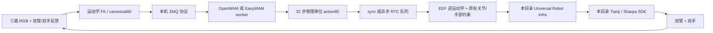

# 独立真机部署目录

> 安装、资源恢复和各任务启动请先阅读 [仓库根目录 README](../README.md)；本文保留历史迁移记录，当前参数以 [配置总结](DEPLOYMENT_CONFIG_SUMMARY.md) 为准。

服务器 `4090-zhenji`，固定根目录：`/home/admin2026/lianjh/real_experiment/deployment`。

这里保存当前部署的代码、配置、独立环境、SDK、模型、参考数据和实验输出。Universal Robot infra、OpenWAM、EasyWAM、MuJoCo-Marvin 都是项目内副本；运行入口不再读取其他人的工程。没有回源软链接或硬链接。原工程保持原样，迁移前本项目的部署文件保存在 `migration/original_flat/`。

## 运行链路



启动器先加载模型及预热，再按记录的示范起点回位，然后启动控制客户端。相机和机器人只在明确传入 `--run` 后连接；默认执行离线路径检查。一次运行的 PID、解析后的配置、worker/client 日志、动作与反馈、停止确认均写入 `runs/<profile>_<时间>/`。

OpenWAM 使用官方源码、checkpoint 自带 tokenizer/stats；EasyWAM v1 使用官方源码、Cosmos、本地 common stats/context。二者共用 observation/action 协议与机器人执行层。RTC 的去噪引导只属于现有 OpenWAM 实验分支。

## 目录

| 目录 | 内容 |
|---|---|
| `src/` | 本项目执行客户端、可靠 SDK 事务、控制时钟、RTC、EasyWAM adapter、统一启动器 |
| `configs/profiles/` | 模型、worker、控制方式、速度等组合配置 |
| `configs/inference/` | OpenWAM 官方推理参数；sync 与 RTC 分开 |
| `vendor/universal_robot_infra/` | 固定版本的 infra 源码与机器人配置 |
| `vendor/mujoco_marvin/` | 回起点及硬件后端所需代码、描述资源 |
| `vendor/openwam/`、`vendor/easywam/` | 官方模型源码快照 |
| `vendor/bridge/` | 协议 codec、ZMQ worker/client、相机、IK、回起点与 context cache |
| `sdk/tianji/`、`sdk/sharpa/` | 本项目 SDK 副本及原生库 |
| `envs/openwam/`、`envs/easywam/`、`envs/robot/` | 独立 Python 环境，保持原包版本 |
| `deps/` | 原部署使用的补充 Python 依赖 |
| `assets/checkpoints/` | 四套模型、normalizer、tokenizer、context |
| `assets/base_models/` | Cosmos-Predict2.5-2B |
| `assets/robot/`、`assets/references/` | URDF/运动学、起点、固定观测样本 |
| `data/episodes_badminton/` | 4090 上现有的 211 个羽毛球 episode |
| `data/episode_top_reference/` | 原项目 top 参考样本 |
| `runs/` | 历史真机日志副本和今后的新运行 |
| `offline_checks/` | 离线验证报告，`history/` 为既有分析副本 |
| `tests/` | 控制、RTC 和启动/清理回归测试 |
| `migration/` | 来源、哈希、版本、修改清单、迁移前文件 |

目录占用约 109 GiB。模型与资源文件约 91.35 GiB，另含三套环境及依赖。遥操及其他工程保持原样；本项目重复副本已按下述清理记录移除。

## 当前配置

| profile | 模型 | 控制 | 速度/加速度 | 手部步长 | 时长 |
|---|---|---|---|---|---|
| `openwam_sync` | `openwam_badminton`（35705） | sync，原即时跟踪阈值 | 20/20 | 2°/tick | 不限时 |
| `openwam_sync_confirm` | `openwam_badminton`（35705） | sync，100 ms 跟踪确认 | 20/20 | 2°/tick | 不限时 |
| `openwam_async_rtc` | `openwam_badminton`（35705） | async + RTC，commit 14 / prefix 20 | 20/20 | 2°/tick | 不限时 |
| `easywam_v1` | `easywam_badminton`（4465） | 原 EasyWAM v1 sync 配置 | 50/50 | 3°/tick | 30 秒 |

上述配置均为 30 Hz、32 步 chunk，模型去噪 10 步；手臂额外 slew limit 为 0，保留原有机械关节限制。OpenWAM sync 保持 DiT cache 开启，RTC 保持关闭；均保留原编译/context cache 设置。EasyWAM 没有新增平滑、KV 复用、软起步或 seed 覆盖。

RTC 仍是 `identity_vjp` 近似实验模式，guidance 上限 10；两次历史真机试验均因持续跟踪误差停止，不代表任务成功。此次迁移没有改变阈值、控制算法、模型权重或 RTC 数学逻辑，也没有重新做真机验收。

`openwam_top` 已通过 `openwam_top_sync` profile 接入独立 top 任务；`easywam_top` 仍仅作为模型资源保存。

## 命令

从本机运行，仍使用项目的 SSH 包装脚本。以下检查不会加载模型或连接机器人：

```bash
bash /Users/lianjh/workspace/real_experiment/remote.sh \
  deployment/envs/robot/bin/python deployment/scripts/launch.py \
  --profile openwam_sync --check
```

现场准备好后，显式真机运行：

```bash
bash /Users/lianjh/workspace/real_experiment/remote.sh \
  deployment/envs/robot/bin/python deployment/scripts/launch.py \
  --profile openwam_async_rtc --run
```

其他配置只替换 `--profile`。`--run` 会回起点并执行，时长按 profile；`--worker-only` 只启动模型进程并等待 Ctrl+C，不连接机器人。GPU 存在计算进程时，启动器拒绝直接占用资源。前台 Ctrl+C 请求停止；清理阶段先回收运动子进程，再确认双臂 idle，并关闭模型专属进程组。

不要直接使用 `migration/original_flat/` 中的旧启动器；这些文件只用于对照和回滚。

## 离线复核

在服务器项目根目录执行：

```bash
deployment/envs/robot/bin/python deployment/scripts/verify_isolation.py
PYTHONDONTWRITEBYTECODE=1 deployment/envs/robot/bin/python deployment/tests/test_execution.py
PYTHONDONTWRITEBYTECODE=1 deployment/envs/openwam/bin/python deployment/tests/test_rtc.py
PYTHONDONTWRITEBYTECODE=1 deployment/envs/robot/bin/python deployment/tests/test_launcher.py
```

迁移校验覆盖：四套权重完整 SHA256、官方源码 577 文件一致、环境未改包的内容校验、活动路径与软链接、真实 profile 下的导入来源、回起点 reference/HDF5/URDF 一致性，以及控制与进程生命周期回归。原始数据图像使用完整路径/大小清单核对，episode manifest/HDF5 另做哈希，不声称每张图像都做了内容哈希。

本次未重新加载 GPU 模型推理，也未连接真机；离线通过不等于迁移后的真机任务成功。

## 隔离范围及后续维护

运行资源不再依赖其他工程。系统 Python 3.10、标准库、操作系统动态库、CUDA 驱动，以及 SDK 所需系统 OpenCV/CUDA/TensorRT 仍由该服务器提供，详见 `migration/env_manifest.json` 和 `migration/hardware_manifest.json`。这些系统依赖未改动。

Moore 上完整的转换后训练数据仍在原训练机；这里迁入的是 4090 已有的原始 episode 和参考样本。废弃 hybrid 权重、重复下载分片不属于当前部署，因此未纳入。

今后修改控制逻辑在 `src/`，改运行参数在 `configs/`。需要升级 Universal 或模型源码时，显式更新本目录的 `vendor/` 副本并重做离线校验。不要把 vendor 或环境改回旧工程的软链接。训练配置、历史日志、来源清单中的旧绝对路径是追溯记录，不是当前运行依赖。

## 2026-11-06 重复数据清理

已清理本项目旧目录中的 894 个重复文件，共 30,472,040,737 B（约 28.38 GiB），均有逐文件 SHA256 一致的 deployment 保留副本。范围为旧 OpenWAM 35705 / EasyWAM v1 权重及配套文件、根目录 runs/offline_checks/checks、ref/physwam 的 top 样本。没有删除任何遥操或其他工程内容，没有终止或启动任何设备进程。

旧 weights 中两套独立 v2/v3 hybrid 模型（约 10.36 GiB）、唯一 manifest/README/下载记录及 ref/openwam 历史转换脚本保留；这些不属于已确认重复文件。旧下载工具仅用于历史追溯，当前统一入口不依赖旧 weights。

清理计划、逐文件保留位置及结果见 migration/cleanup_duplicates_plan.json、migration/cleanup_duplicates_result.json。清理后隔离检查和四份 profile 的离线路径检查全部通过。

## 模型名称

统一模型目录在 `/home/admin2026/lianjh/real_experiment/deployment/assets/checkpoints/`：

| 模型名/目录名 | 原训练步数 |
|---|---|
| `openwam_badminton` | 35705 |
| `openwam_top` | 33050 |
| `easywam_badminton` | 4465（v1） |
| `easywam_top` | 4131 |

目录内部保留官方 checkpoint 文件名，支持 OpenWAM 按 `checkpoint_step_N.safetensors` 自动发现。权重内容和配套 config/stats/tokenizer/context 均未改动。模型清单为 `assets/checkpoints/models.json`，保存训练步数、文件名和原校验值。运行 profile 名保持不变。

历史日志、迁移/清理报告中的旧目录名保留作来源记录；对应关系见 `migration/model_rename_20261106.json`。当前入口均使用新目录。

## 2026-11-08 执行层修复

首帧手部限速、关闭失败传播、回起点SDK事务检查、观测时间戳和RTC取消恢复已修复。100项CPU测试及OpenWAM/EasyWAM/RTC真实离线推理复验通过；模型权重和推理配置未改。详见 `offline_checks/fixes_20261108/SUMMARY.md` 和 `runtime_changes.diff`。真机通信与真实跟踪效果待连接后确认。


## OpenWAM top（2026-11-08）

使用 `--profile openwam_top_sync`，33050 权重、checkpoint 自带 stats/tokenizer，
训练指令为 `pull the string to spin the top on the table`。
控制沿用 sync 30 Hz、20/20 速度加速度、2°手部步长、不限时，推理配置仍为 openwam_sync.yaml。

独立起点为 `assets/references/top_demo_origin.json`，来自 top 原始示范首帧实测关节；
该示范开头没有满足原静止窗口规则的片段，因此没有把中途静止姿态冒充起点。
回起点、客户端起点校验、预热画面和任务 prompt 均按 top 配套使用。
参考画面及时间对齐审计在 `assets/references/top_observations/`，
生成脚本为 `scripts/prepare_top_assets.py`（用现有 OpenWAM 环境运行，仅读取记录数据）。
运行后若要单独回起点，return_full_origin.py 的 --reference 必须选 top_demo_origin.json。
本轮准备与验证记录在 `offline_checks/top_task_20261108/`。

## OpenWAM bottle（2026-11-08）

新增 profile openwam_bottle_sync，使用独立 openwam_bottle 65640 权重与配套统计、tokenizer。任务指令为 unscrew the bottle cap and pour water into the cup。控制参数与 top 相同。独立起点为 assets/references/bottle_demo_origin.json，来自原始 episode_0002 的起始静止窗口；回位时必须选择该参考。验证记录见 offline_checks/bottle_setup_20261108。

### Bottle 录像参考修正

2026-11-08 已移除录制视频转预热样本时的重复腕部旋转。实时相机安装角度补偿未改；state与示范起点未改。生成器不再重写profile。原样本备份及缩放GT对照见 offline_checks/bottle_reference_fix_20261108/SUMMARY.md。部署缩放仍保留原BILINEAR，未自动应用离线LANCZOS对照。

### 三任务预处理核验

2026-11-08 top录像参考已修复重复旋转；badminton两组录像参考逐像素核验无此问题，历史实机JPEG重建样本仅能校验既有哈希。三任务共同存在训练LANCZOS/部署BILINEAR缩放差异，本轮未改部署实现。详见 offline_checks/preprocessing_all_tasks_20261108/SUMMARY.md。修复后的top与bottle录像输入不应再施加安装角度旋转；实时相机补偿保持不变。

### 可选 LANCZOS 路径（2026-11-08）

原有profile默认继续使用BILINEAR。新增以下配对配置，仅worker的image-resize参数不同：
- openwam_sync → openwam_badminton_sync_lanczos
- openwam_top_sync → openwam_top_sync_lanczos
- openwam_bottle_sync_no_dit_cache → openwam_bottle_sync_no_dit_cache_lanczos

新路径在解码后、官方ObsPreprocessor之前，按训练读取器的LANCZOS方式缩放至头部320x256、两腕各160x128，再走原有拼接。限定已核验的384x320三视角，其他几何显式拒绝。
官方模型源码、权重、动作与状态处理不变；不添加动作平滑。BILINEAR不预缩放，保留原始调用路径。
预热和真实请求共享同一选项；worker_ready.json记录image_resize。bottle的新配置保留DiT cache关闭，其他两项保留各自原配置。
本次不自动修改runs/current_task.json或启动真机。验证见offline_checks/resize_path_20261108。
